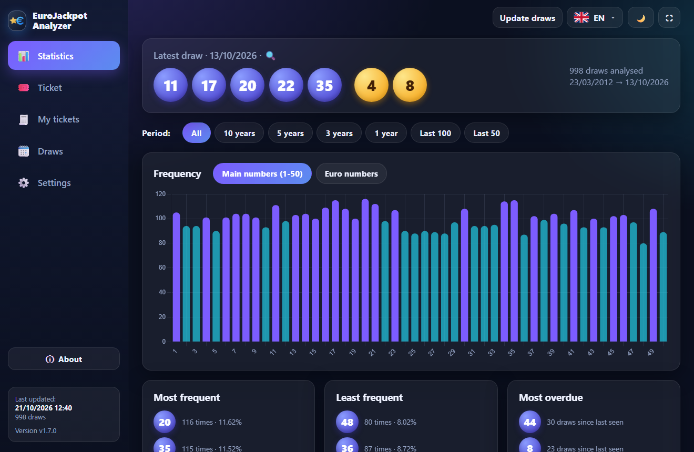
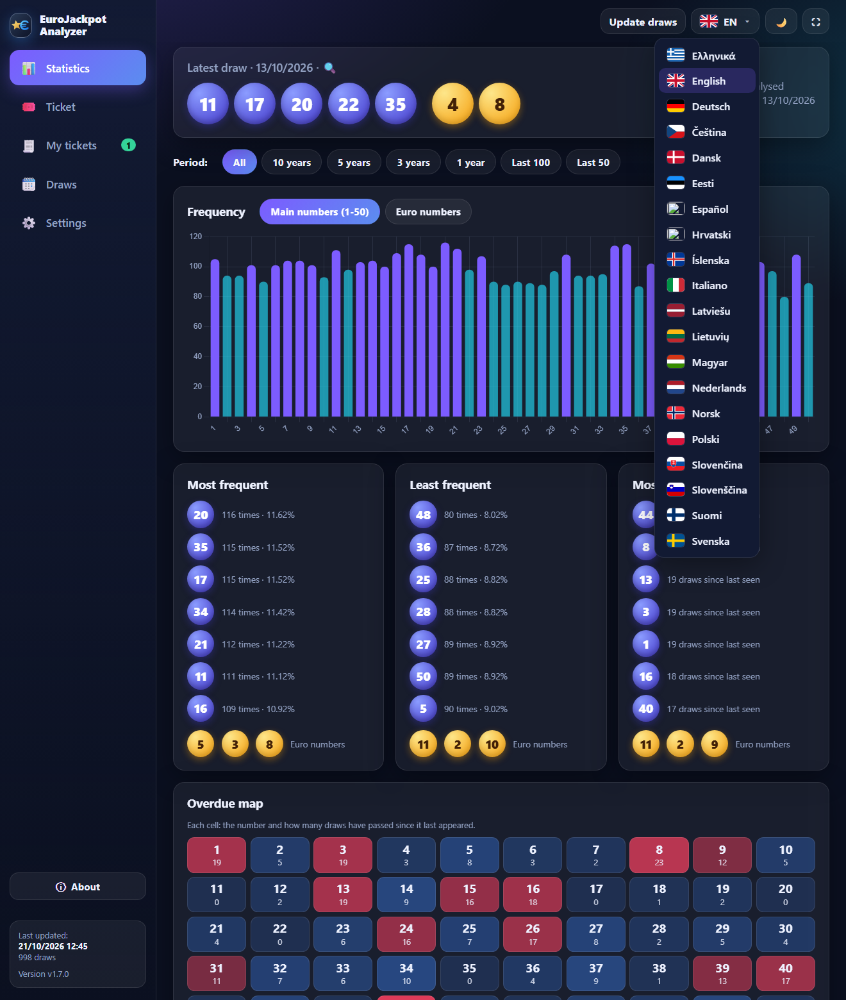
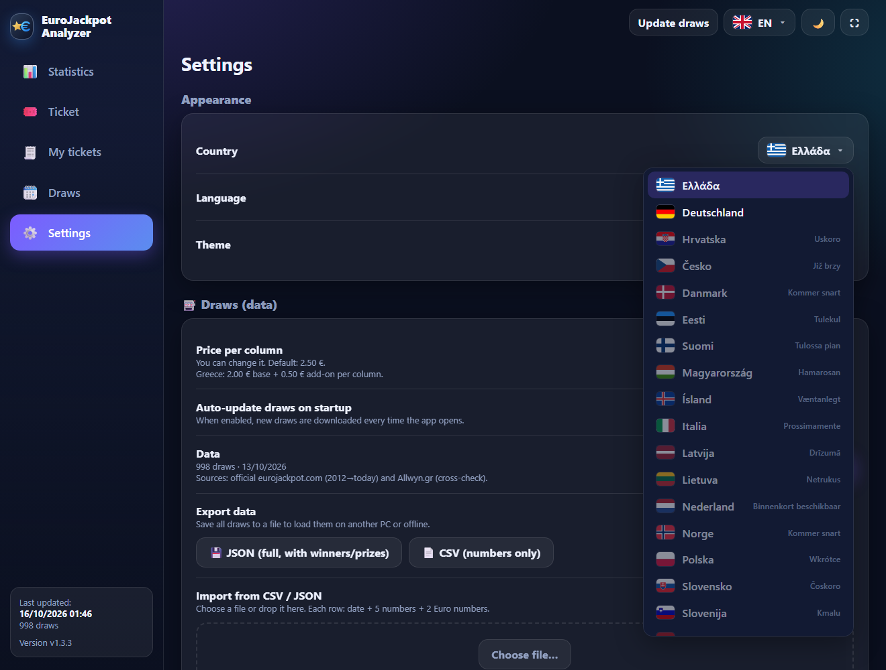
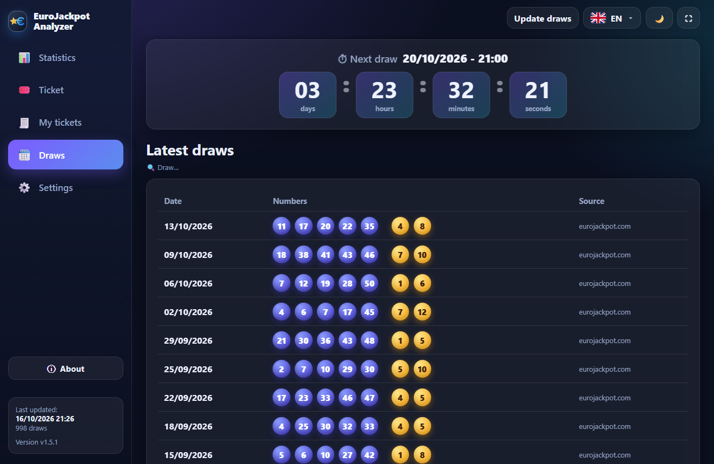
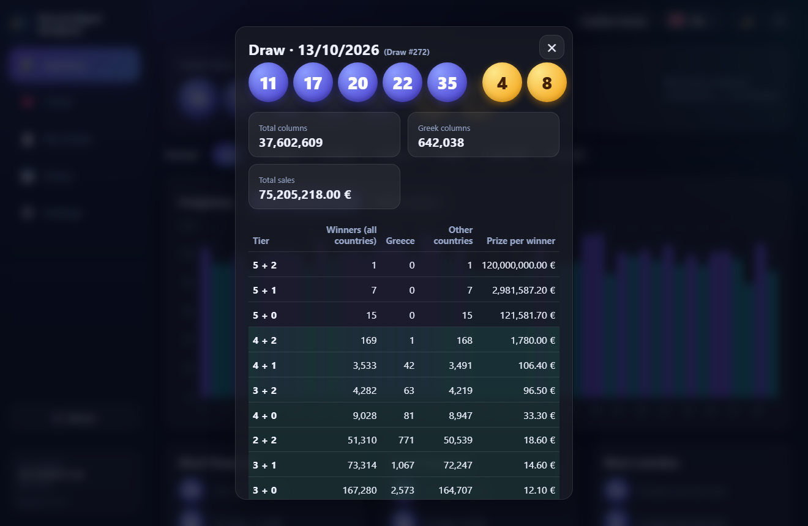
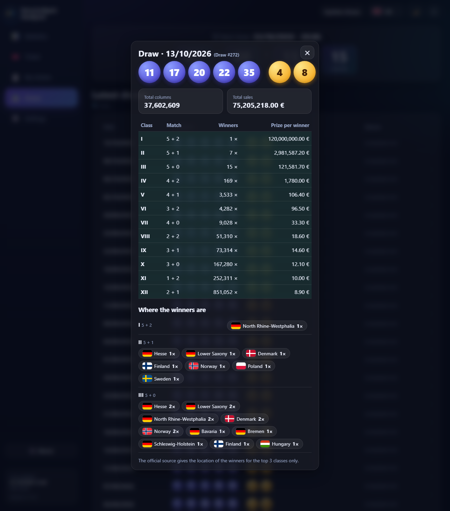
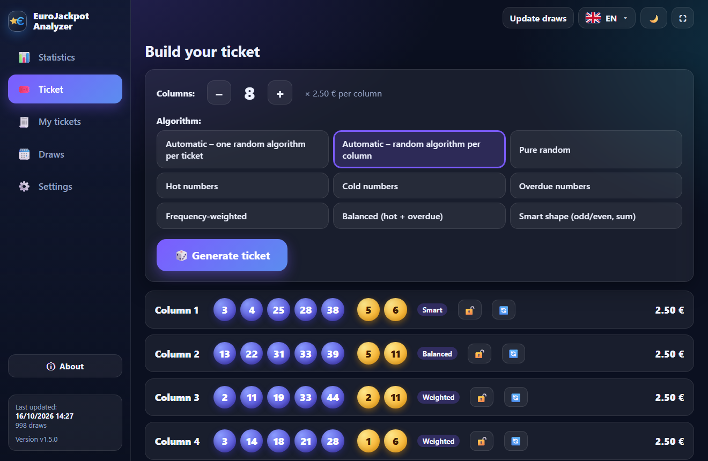
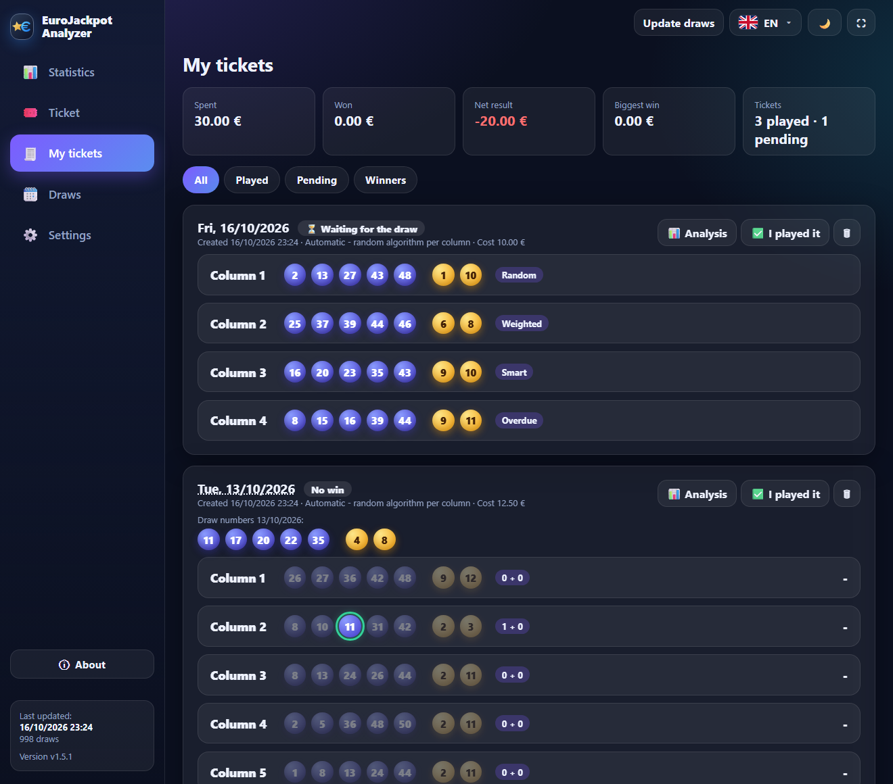
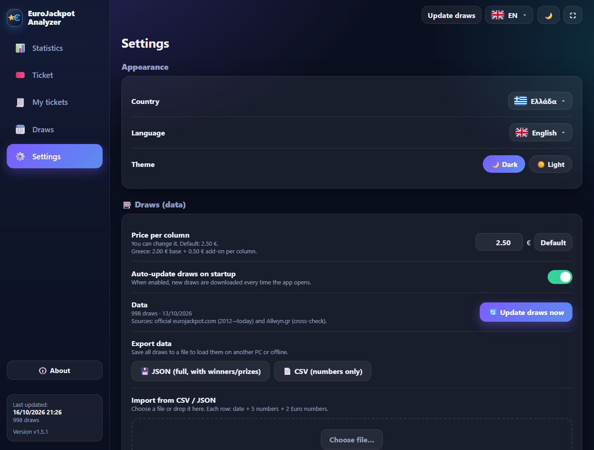
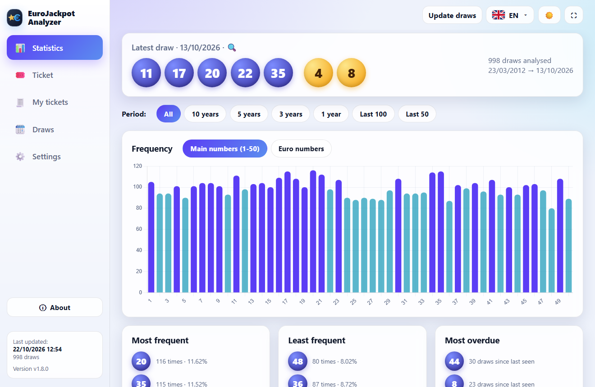

# EuroJackpot Analyzer

🇬🇷 **[Ελληνικές οδηγίες → README.md](README.md)**

An app for **Windows** (portable) and **Mac** that:
- downloads the complete EuroJackpot history (since 23 March 2012) and keeps it up to date by itself,
- shows statistics with charts (frequency, overdue numbers, odd/even, sum, pairs),
- shows the winners and prizes of every draw **the way they are presented in your country** (Greece or Germany) and where the top prizes were won,
- shows the **next draw with a countdown**,
- builds tickets of 1–12 columns (price per column set per country, editable) with 7 algorithms or an automatic choice,
- **keeps a history of your tickets and checks them automatically as soon as the draw is out**, with the prize amount and your overall result,
- exports/imports your data (JSON, CSV) and updates itself from GitHub with one click.

Greek / English / German, dark / light theme, window or full screen (F11).

---

## User guide

### 1. Installation and first start
1. Download `EuroJackpotApp-portable-win.zip` from the **Releases** page and extract it to any folder.
2. Run `EuroJackpotApp.exe`. No installation is needed. It only requires *Microsoft Edge WebView2*, which is already part of Windows 10/11.
3. The app opens immediately with the history bundled inside it. If you are online it also downloads the newest draws.
4. Your data and settings are stored in the `data` folder next to the exe. To move the app to another PC, copy the whole folder.

#### Installation on a Mac
1. From the **Releases** page download the zip that matches your Mac: `EuroJackpotApp-mac-arm64.zip` for **Apple Silicon** (M1, M2, M3, M4) or `EuroJackpotApp-mac-intel.zip` for **Intel**. (Apple menu → About This Mac → Chip / Processor.)
2. Open the zip and drag **EuroJackpot Analyzer** into your **Applications** folder.
3. The first time, macOS says the app cannot be verified because it has no paid Apple signature. **Right-click (or Control-click) the app → Open → Open**. It appears once. If there is no Open button: **System Settings → Privacy & Security → “Open Anyway”**. Alternatively, in Terminal: `xattr -dr com.apple.quarantine "/Applications/EuroJackpot Analyzer.app"`.
4. Your data and settings are stored in `~/Library/Application Support/EuroJackpot Analyzer`. Updating the app (Settings → Application) works on the Mac too, as long as the app sits in a folder you can write to (e.g. Applications). Otherwise download the new zip from the Releases page.
5. All features are the same as on Windows. Import and export use the normal macOS file dialogs.

### 2. Choosing your country and language
On the first start the **“Choose your country”** screen appears, with the flags of the EuroJackpot countries. Move the mouse over a flag and it lights up in colour while all the others stay grey.

- Available now: **Greece** and **Germany**. The other countries show “coming soon” in their own language and will be added later.
- After the country you choose a language: **the local one and English** (e.g. a German resident who only speaks English picks Germany → English).
- The country decides **how the draws are displayed** (see below) and the **default column price**.
- Later you can change the language from the **flag menu at the top right** (ΕΛ / EN / DE, each language written in its own language) or in Settings, where you can also change the **country**:

### 3. Statistics
The start screen shows the latest draw and the statistics of all draws.
- **Period**: choose All, 10, 5, 3, 1 years or the last 100 / 50 draws.
- **Frequency**: bars for the main numbers (1–50) or the Euro numbers. Hover a bar to see the percentage and how overdue the number is.
- **Most frequent / Least frequent / Most overdue**: the top 7 main numbers and 3 Euro numbers of each list.
- **Overdue map**: each cell shows the number and how many draws have passed since it last appeared (redder = more overdue).
- Odd/even and low/high charts, the sum distribution and the most common pairs.

> The Euro numbers pool changed over time (1–8, 1–10 from 10/2014, 1–12 from 3/2022). The statistics only count draws in which the number existed.

### 4. Draws and details
In the **Draws** menu you first see the **“Next draw”** box with the date and time (in your country's time) and a **countdown** `DD : HH : MM : SS` (days, hours, minutes, seconds). Below it are the latest 100 draws:

**Click a draw** (or the latest draw on the start screen) to see the winners and prizes per class:

- **Greece** (Allwyn style): **Winners (all countries)**, **Greece** and **Other countries** (available from 8 March 2024, when Greece joined the game).
- **Prize per winner**, **total columns** and **total sales** of the draw.
- The **1 + 1** class exists only in Greece.
- For the other classes the sources only give the total of all countries and Greece.

**With Germany as your country** the draw is shown like on the official eurojackpot.com: *Class* (I–XII), *Match* (e.g. “5 numbers + 2 Euro numbers”), *Winners* (e.g. “7 ×”) and *Prize per winner*, plus the total sales and fields. Below the table, **“Where the winners are”** shows in which country (and, for Germany, in which federal state) the winners were found. The official source gives this information **for the top 3 classes only**.

### 5. Building a ticket

1. Choose **1–12 columns** with the − / + buttons.
2. Choose an **algorithm**:
   - *Automatic – one random algorithm per ticket*, or *a random algorithm per column*.
   - *Pure random, Hot numbers, Cold numbers, Overdue numbers, Frequency-weighted, Balanced, Smart shape (odd/even, sum)*.
3. Press **Generate ticket**. Next to every column you see the algorithm that created it and its price (€2.50 in Greece, €2.00 in Germany, or the price you set in Settings). Below is the **ticket total**.
4. 🔒 locks a column you like, 🔄 regenerates only that one, and **Copy** puts the whole ticket on the clipboard as text.
5. At the bottom you see that the ticket was **saved to your history** for the next draw (you can pick another date). If you really play it, press **“I played it”**.
   As long as it is not marked as played, generating again replaces the suggestion instead of filling the history.

> Draws are random. Statistics are informational and do not improve your odds. Play responsibly (18+).

### 6. My tickets: history and prize check

The **My tickets** tab lists every ticket you made, newest first:
- **Automatic check**: as soon as the draws are updated (“Update draws” button, or automatically at startup) every ticket is compared with the draw it was made for. The numbers that were drawn are marked in green, and every column shows its class (e.g. *3 + 1*) and the **prize amount**.
- **Notification**: if a ticket you played wins, a message appears and a green number shows next to the tab.
- **Totals**: spent, won, net result and biggest win. They count **only tickets marked “I played it”**. The others stay as “Suggestion (not played)” and are checked too, without entering the totals.
- **Filters**: All, Played, Pending, Winners. Click the date to open the draw details.
- The amounts come from the real prizes of the draw. The **1 + 1** class (€0.50 add-on) pays €2.50 and exists only for draws since 8 March 2024.
- The ticket history is **included in the JSON export** and loads together with the draws on another PC.

### 7. Settings: country, language, price, theme, data, export and import

The **country**, **language** (Greek / English / German) and **theme** (dark / light) change instantly. The **price per column** is editable for each country: €2.50 in Greece (€2.00 + €0.50 add-on), €2.00 per field in Germany plus the handling fee of the provider you play with. Enter the amount you actually pay and press “Default” to go back to the original value. The price is used for tickets and spending totals. Example with the light theme:

**Updating draws** and **updating the app** are two different things:

| | What changes | Where |
|---|---|---|
| **Update draws** | The draw results | “Update draws” button (top right) or automatically at startup (switch in Settings) |
| **Update the app** | The program itself (new version) | Settings → Application → “Check for new version”. A green badge appears in the menu when a new version exists |

- **Export data**: saves all draws as **JSON** (complete, with winners and prizes) or **CSV** (numbers only) so you can load them on another PC or in another program, even offline.
- **Import from CSV / JSON**: choose a file or drop it in the box. It accepts the files the app itself exports and plain CSV with date + 5 numbers + 2 Euro numbers. Draws are merged without duplicates.
- **Connection check**: tests every online source separately and shows the error. “Copy report” lets you send it for diagnosis.
- **Check and install a new version** (bottom of the page): when a new version exists its changes are shown. “Install and restart” downloads the new zip from GitHub, verifies the SHA-256, replaces the files (the `data` folder with your data and tickets is left untouched) and reopens the app.

### 8. If the online update does not work
The app **never blocks**. It has the history built in, so it always opens with data. If there is no data at all, a screen appears where you can **load a draws file manually** (button or drag & drop), try again or run the **Connection check**.

Typical causes of a `403 Forbidden` error: a VPN, a corporate network/proxy or an antivirus that blocks the external API. Try without the VPN or from another network, or use export/import from a PC that works.

### 9. Startup problems
- **“Windows protected your PC” (SmartScreen)**: the app is not digitally signed (that needs a paid certificate), so Windows treats it as an “unknown publisher”. Click **More info → Run anyway**. It appears once.
- **Error `Failed to resolve Python.Runtime.Loader.Initialize` (older versions)**: Windows marks the files of a zip downloaded from the internet as “blocked” and on some PCs .NET refuses to load the DLL. Since version 1.1.3 the app removes the mark by itself. On an older version run `Get-ChildItem "<app folder>" -Recurse | Unblock-File` in PowerShell, or right-click the zip → *Properties* → **Unblock** before extracting.
- If the native window still cannot open, the app automatically opens in an Edge window (app mode) and works normally. The error is written to `data\startup.log`.
- **White window or nothing opens**: install the *Microsoft Edge WebView2 Runtime* from Microsoft. If that does not help, run `EuroJackpotApp.exe --browser`.
- Requirements: Windows 10 (1803+) or 11, with Microsoft Edge.

---

## For developers

- **From source**: `python -m venv .venv && .venv\Scripts\pip install -r requirements.txt && .venv\Scripts\python run.py`
- **Browser dev mode**: `python -m app.devserver 8765`, then open http://127.0.0.1:8765/index.html. Helpful URL params (docs/screenshots): `#view=ticket&country=GR&lang=en&theme=light&draw=2026-10-13&gen=8`, `#splash=1&hover=GR,PL` (country screen), `#menu=lang-dd` (open dropdown)
- **Tests**: `.venv\Scripts\python -m pytest -q`
- **Offline seed** (bundled history): `python -m tools.make_seed`
- **Build**: `powershell -ExecutionPolicy Bypass -File build\build_windows.ps1` → `dist\EuroJackpotApp\`
- **Build for Mac**: on a Mac `sh build/build_mac.sh` → `dist/EuroJackpotApp-mac-<arm64|intel>.zip`. On GitHub `.github/workflows/mac.yml` runs it for every new release (Apple Silicon + Intel), runs the tests and a startup check (`--selftest`) and adds the zips to the release.
- **Release** (needs `gh auth login` and `GITHUB_REPO` in `app/version.py`): `powershell -ExecutionPolicy Bypass -File build\release.ps1`

### Countries and languages
`app/ui/countries.json` lists the languages, the countries (own/English/Greek/German names, flag, local language, result layout `allwyn` or `official`, default price, draw time and zone) and the German state names. A country with `"supported": false` shows its `soon` text in its own language. To add a country: add its fields, a locale file in `app/locales/` if it brings a new language, and a layout in `openDraw()` (`app/ui/app.js`).
Flags are from [flag-icons](https://github.com/lipis/flag-icons) (MIT, see `app/ui/flags/LICENSE-flag-icons.txt`).

### Data sources
- Official EuroJackpot service (eurojackpot.com): full history since 2012-03-23, numbers + prizes, and (top 3 classes) where the winners are by country / German state.
- Allwyn/OPAP API (game 5149): since 2024-03-08, Greek winners; fallback and cross-check.
- Manual import of JSON / CSV.
