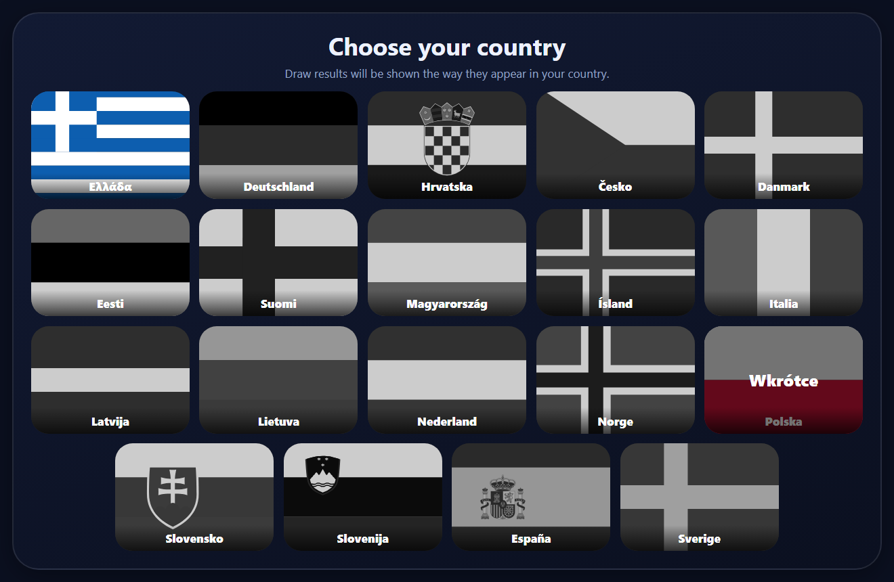
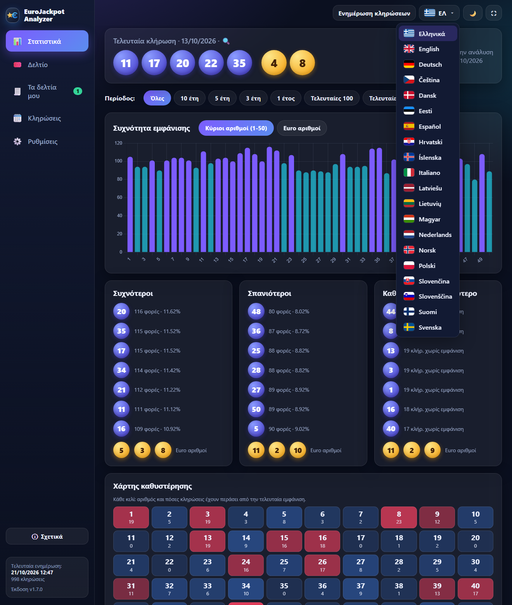
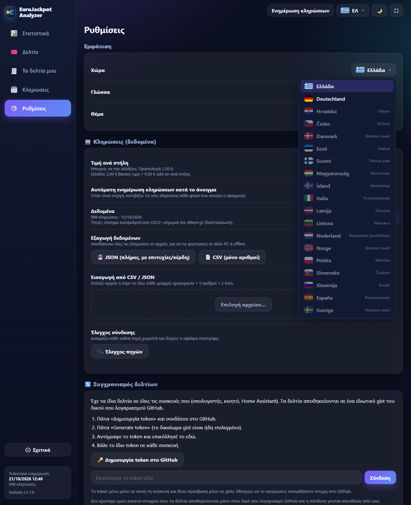
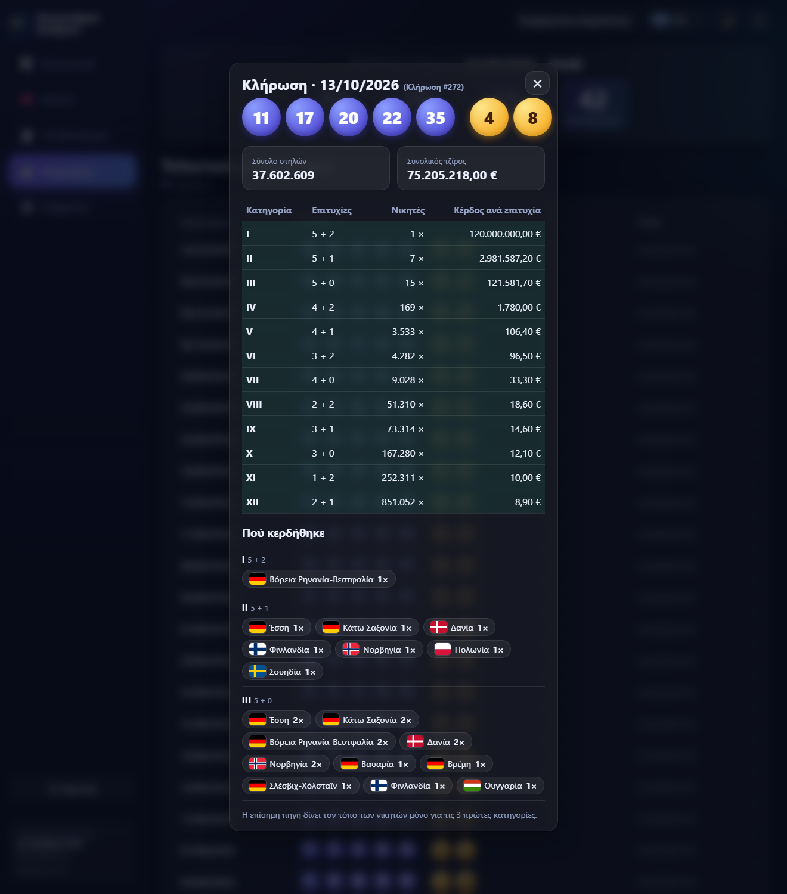
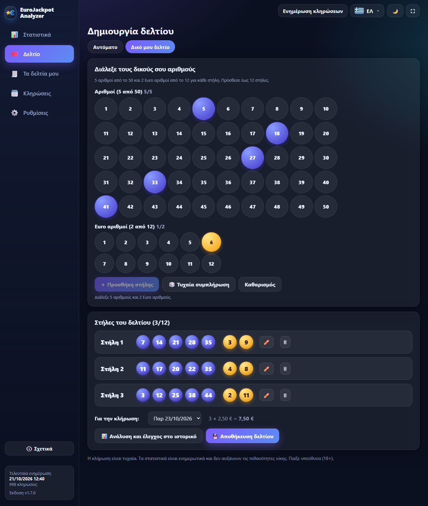
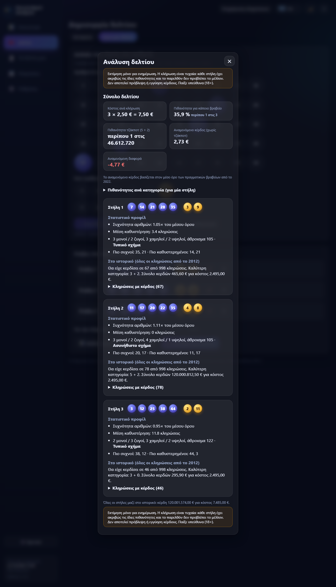
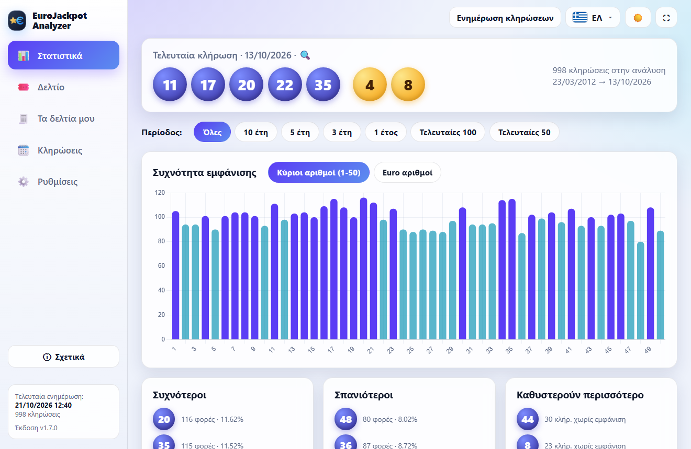
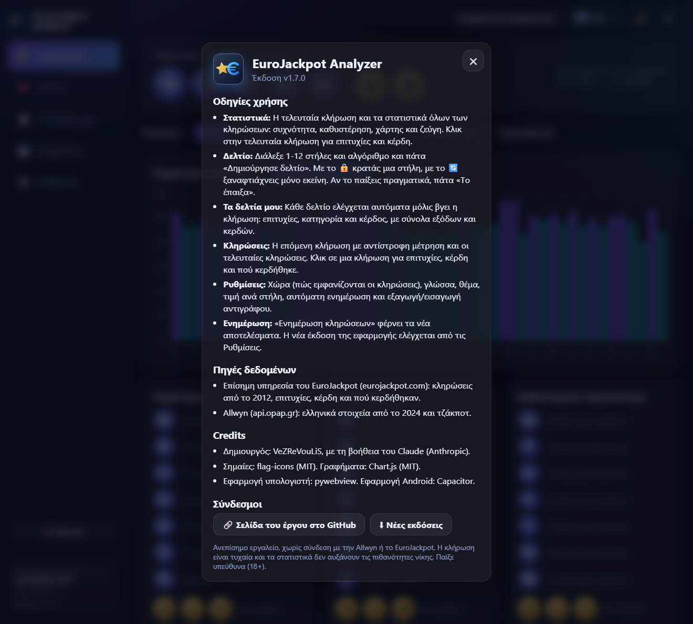
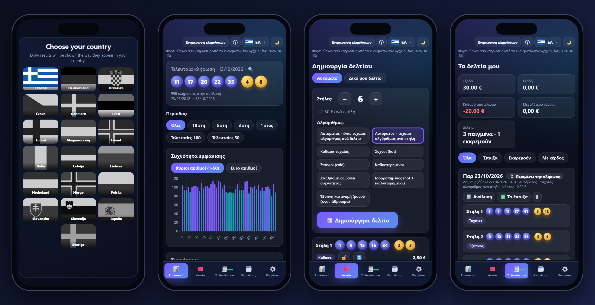
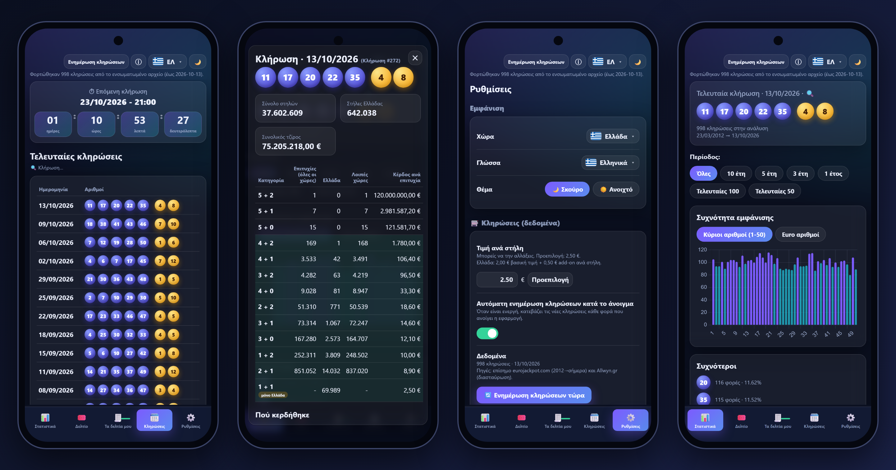

# EuroJackpot Analyzer

🇬🇧 **[English instructions → README.en.md](README.en.md)**

Πρόγραμμα για **Windows** (portable), **Mac**, **iPhone / iPad** και **Android** που:
- κατεβάζει όλο το ιστορικό του EuroJackpot (από 23/3/2012) και το ενημερώνει μόνο του,
- δείχνει στατιστικά με γραφήματα (συχνότητα, καθυστέρηση, μονοί/ζυγοί, άθροισμα, ζεύγη),
- δείχνει για κάθε κλήρωση τις επιτυχίες και τα κέρδη **όπως παρουσιάζονται στη χώρα σου** (Ελλάδα ή Γερμανία) και πού κερδήθηκε το τζάκποτ,
- δείχνει την **επόμενη κλήρωση με αντίστροφη μέτρηση**,
- φτιάχνει δελτία 1-12 στηλών (τιμή ανά στήλη ανά χώρα, ρυθμιζόμενη) με 7 αλγορίθμους ή αυτόματη επιλογή,
- **κρατά ιστορικό των δελτίων σου και τα ελέγχει αυτόματα μόλις βγει η κλήρωση**, με ποσό κέρδους και συνολικό αποτέλεσμα,
- σου επιτρέπει να φτιάξεις **δικό σου δελτίο** και το **αναλύει** (πιθανότητες, αναμενόμενο κόστος και κέρδος, έλεγχος σε όλο το ιστορικό),
- **συγχρονίζει τα δελτία** ανάμεσα στις συσκευές σου και στο Home Assistant (ιδιωτικό gist στο GitHub σου),
- εξάγει/εισάγει τα δεδομένα σου (JSON, CSV) και ενημερώνεται από GitHub με ένα κλικ.

**20 γλώσσες** (οι γλώσσες όλων των χωρών του EuroJackpot), σκούρο / ανοιχτό θέμα, παράθυρο ή πλήρης οθόνη (F11).

---

## Οδηγίες χρήσης

### 1. Εγκατάσταση και πρώτη εκκίνηση
1. Κατέβασε το `EuroJackpotApp-portable-win.zip` από τη σελίδα **Releases** και κάν' το «Εξαγωγή όλων» σε οποιονδήποτε φάκελο.
2. Τρέξε το `EuroJackpotApp.exe`. Δεν χρειάζεται εγκατάσταση. Χρειάζεται μόνο το *Microsoft Edge WebView2*, που υπάρχει ήδη σε Windows 10/11.
3. Η εφαρμογή ανοίγει αμέσως με το ιστορικό που περιέχει μέσα της. Αν υπάρχει internet, κατεβάζει και τις νεότερες κληρώσεις.
4. Τα δεδομένα και οι ρυθμίσεις σώζονται στον φάκελο `data` δίπλα στο exe. Για να μεταφέρεις την εφαρμογή σε άλλο PC, αντίγραψε όλο τον φάκελο.

#### Εγκατάσταση σε Mac
1. Από τη σελίδα **Releases** κατέβασε το zip που ταιριάζει στο Mac σου: `EuroJackpotApp-mac-arm64.zip` για **Apple Silicon** (M1, M2, M3, M4) ή `EuroJackpotApp-mac-intel.zip` για **Intel**. (Μενού Apple → Σχετικά με αυτό το Mac → Τσιπ / Επεξεργαστής.)
2. Άνοιξε το zip και σύρε το **EuroJackpot Analyzer** στον φάκελο **Εφαρμογές** (Applications).
3. Την πρώτη φορά το macOS μπλοκάρει την εφαρμογή («Η Apple δεν ήταν δυνατό να επαληθεύσει…»), γιατί δεν έχει πληρωμένη υπογραφή Apple. Δεν είναι κακόβουλο λογισμικό. **Πάτα «Τέλος» (όχι «Μετακίνηση στον Κάδο»)** και μετά κάνε ένα από τα δύο:
   - **Ρυθμίσεις συστήματος → Απόρρητο και ασφάλεια**, κάτω κάτω στην ενότητα «Ασφάλεια» πάτα **«Άνοιγμα ούτως ή άλλως»** δίπλα στο μήνυμα για το EuroJackpot Analyzer, και επιβεβαίωσε με τον κωδικό σου. Γίνεται μία φορά.
   - ή στο Terminal (τρέχει και πριν την πρώτη εκκίνηση): `xattr -dr com.apple.quarantine "/Applications/EuroJackpot Analyzer.app"`.
   Στα παλιότερα macOS (πριν το Sequoia) αρκεί και δεξί κλικ (ή Control + κλικ) → Άνοιγμα → Άνοιγμα.
4. Τα δεδομένα και οι ρυθμίσεις σώζονται στο `~/Library/Application Support/EuroJackpot Analyzer`. Η ενημέρωση της εφαρμογής (Ρυθμίσεις → Εφαρμογή) δουλεύει και στο Mac, αρκεί η εφαρμογή να βρίσκεται σε φάκελο όπου έχεις δικαίωμα εγγραφής (π.χ. Εφαρμογές). Αλλιώς κατέβασε το νέο zip από τη σελίδα Releases.
5. Όλες οι λειτουργίες είναι ίδιες με τα Windows. Η εξαγωγή και η εισαγωγή αρχείων χρησιμοποιούν τα κανονικά παράθυρα αρχείων του macOS.

### 2. Επιλογή χώρας και γλώσσας
Στην πρώτη εκκίνηση εμφανίζεται η οθόνη **«Choose your country»** με τις σημαίες των χωρών του EuroJackpot. Περνάς το ποντίκι πάνω από μια σημαία και «ανάβει» με χρώματα, ενώ οι υπόλοιπες μένουν γκρι.

- Διαθέσιμες τώρα: **Ελλάδα** και **Γερμανία**. Οι υπόλοιπες χώρες δείχνουν «σύντομα» στη γλώσσα τους και θα προστεθούν αργότερα.
- Μετά τη χώρα διαλέγεις γλώσσα: **η τοπική και English** (π.χ. ένας Γερμανός που μιλά μόνο αγγλικά διαλέγει Γερμανία → English). Στις Ρυθμίσεις μπορείς να διαλέξεις **οποιαδήποτε από τις 20 γλώσσες**: Ελληνικά, English, Deutsch, Čeština, Dansk, Eesti, Español, Hrvatski, Íslenska, Italiano, Latviešu, Lietuvių, Magyar, Nederlands, Norsk, Polski, Slovenčina, Slovenščina, Suomi, Svenska. Οι μεταφράσεις πέρα από τα ελληνικά, αγγλικά και γερμανικά έγιναν με τεχνητή νοημοσύνη και δεν τις έχει ελέγξει φυσικός ομιλητής. Αν δεις κάτι που δεν ακούγεται σωστό, γράψε μας στο GitHub (Issues) και διορθώνεται εύκολα.
- Η χώρα ορίζει **πώς εμφανίζονται οι κληρώσεις** (βλ. παρακάτω) και την **προεπιλεγμένη τιμή στήλης**.
- Αργότερα αλλάζεις γλώσσα από το **μενού με σημαίες πάνω δεξιά** (ΕΛ / EN / DE, κάθε γλώσσα γραμμένη στη δική της) ή από τις Ρυθμίσεις, όπου αλλάζεις και **χώρα**:

### 3. Στατιστικά
Η αρχική οθόνη δείχνει την τελευταία κλήρωση και τα στατιστικά όλων των κληρώσεων.
- **Περίοδος**: διάλεξε Όλες, 10, 5, 3, 1 έτη ή τις τελευταίες 100 / 50 κληρώσεις.
- **Συχνότητα εμφάνισης**: μπάρες για τους κύριους αριθμούς (1-50) ή τους Euro αριθμούς. Με το ποντίκι πάνω σε μια μπάρα βλέπεις ποσοστό και καθυστέρηση.
- **Συχνότεροι / Σπανιότεροι / Καθυστερούν περισσότερο**: οι 7 πρώτοι κύριοι και οι 3 Euro αριθμοί κάθε λίστας.
- **Χάρτης καθυστέρησης**: κάθε κελί δείχνει τον αριθμό και πόσες κληρώσεις έχουν περάσει από την τελευταία φορά που βγήκε (πιο κόκκινο = καθυστερεί περισσότερο).
- Πίτες μονοί/ζυγοί και χαμηλοί/υψηλοί, κατανομή αθροίσματος και τα πιο συχνά ζεύγη.

> Οι Euro αριθμοί άλλαξαν εύρος στο παρελθόν (1-8, από 10/2014 1-10, από 3/2022 1-12). Τα στατιστικά μετρούν μόνο τις κληρώσεις στις οποίες ο αριθμός υπήρχε.

### 4. Κληρώσεις και λεπτομέρειες
Στο μενού **Κληρώσεις** βλέπεις πρώτα το πλαίσιο **«Επόμενη κλήρωση»** με ημερομηνία και ώρα (ώρα της χώρας σου) και **αντίστροφη μέτρηση** `ΗΗ : ΩΩ : ΛΛ : ΔΔ` (ημέρες, ώρες, λεπτά, δευτερόλεπτα). Από κάτω είναι οι τελευταίες 100 κληρώσεις:

**Κάνε κλικ σε μια κλήρωση** (ή στην τελευταία κλήρωση της αρχικής οθόνης) για να δεις τις επιτυχίες και τα κέρδη ανά κατηγορία:

- **Ελλάδα** (προβολή όπως στην Allwyn): **Επιτυχίες (όλες οι χώρες)**: το σύνολο των νικητών σε όλες τις συμμετέχουσες χώρες.
- **Ελλάδα** και **Λοιπές χώρες**: οι νικητές στην Ελλάδα και οι υπόλοιποι (διαθέσιμο από 8/3/2024, όταν μπήκε η Ελλάδα στο παιχνίδι).
- **Κέρδος ανά επιτυχία**, **σύνολο στηλών** και **τζίρος** της κλήρωσης.
- Η κατηγορία **1 + 1** ισχύει μόνο στην Ελλάδα.
- Οι πηγές δεν δίνουν ανάλυση ανά χώρα για όλες τις κατηγορίες, μόνο σύνολο όλων των χωρών και Ελλάδα.

**Με χώρα Γερμανία** η κλήρωση εμφανίζεται όπως στο επίσημο eurojackpot.com: *Κατηγορία* (I-XII), *Επιτυχίες* (π.χ. «5 + 2»), *Νικητές* (π.χ. «7 ×») και *Κέρδος ανά νικητή*, μαζί με τον συνολικό τζίρο και τα πεδία. Οι κατηγορίες που κερδήθηκαν έχουν πράσινο φόντο, όπως στην ελληνική προβολή. Κάτω από τον πίνακα η ενότητα **«Πού κερδήθηκε»** δείχνει σε ποια χώρα (και, για τη Γερμανία, σε ποιο κρατίδιο) βρέθηκαν οι νικητές. Η επίσημη πηγή δίνει αυτή την πληροφορία **μόνο για τις 3 πρώτες κατηγορίες**.

### 5. Δημιουργία δελτίου

1. Διάλεξε **1-12 στήλες** με τα κουμπιά − / +.
2. Διάλεξε **αλγόριθμο**:
   - *Αυτόματος - ένας τυχαίος αλγόριθμος ανά δελτίο*, ή *τυχαίος αλγόριθμος ανά στήλη*.
   - *Καθαρά τυχαίος, Συχνοί (hot), Σπάνιοι (cold), Καθυστερημένοι, Σταθμισμένος βάσει συχνότητας, Ισορροπημένος, Έξυπνη κατανομή (μονοί/ζυγοί, άθροισμα)*.
3. Πάτα **Δημιούργησε δελτίο**. Δίπλα σε κάθε στήλη φαίνεται ο αλγόριθμος που τη δημιούργησε και η τιμή της (2,50 € στην Ελλάδα, 2,00 € στη Γερμανία, ή η τιμή που όρισες στις Ρυθμίσεις). Κάτω φαίνεται το **σύνολο του δελτίου**.
4. Με το 🔒 κλειδώνεις μια στήλη που σου αρέσει, με το 🔄 ξαναφτιάχνεις μόνο εκείνη και με το **Αντιγραφή** παίρνεις όλο το δελτίο ως κείμενο.
5. Στο κάτω μέρος βλέπεις ότι το δελτίο **αποθηκεύτηκε στο ιστορικό** για την επόμενη κλήρωση (μπορείς να διαλέξεις άλλη ημερομηνία). Αν το παίξεις πραγματικά, πάτα **«Το έπαιξα»**.
   Όσο δεν το έχεις σημειώσει ως παιγμένο, ένα νέο «Δημιούργησε δελτίο» αντικαθιστά την πρόταση, χωρίς να γεμίζει το ιστορικό.

#### Δικό μου δελτίο
Στο πάνω μέρος της καρτέλας **Δελτίο** διάλεξε **«Δικό μου δελτίο»** αντί για «Αυτόματο». Εμφανίζεται πίνακας με τους αριθμούς 1-50 και 1-12:

1. Πάτα **5 αριθμούς** και **2 Euro αριθμούς**. Ο πίνακας δεν σε αφήνει να βάλεις περισσότερους.
2. **Τυχαία συμπλήρωση** διαλέγει αριθμούς για σένα, **Καθαρισμός** αδειάζει την επιλογή. Πάτα **Προσθήκη στήλης**: η στήλη μπαίνει στη λίστα «Στήλες του δελτίου», όπου μπορείς να την επεξεργαστείς ή να τη διαγράψεις. Έως 12 στήλες.
3. Πάτα **Αποθήκευση δελτίου**. Μπαίνει στα **Τα δελτία μου** για την επόμενη κλήρωση, και αν το παίξεις πραγματικά πάτα **«Το έπαιξα»**. Το **Ανάλυση και έλεγχος στο ιστορικό** ανοίγει την ανάλυση.

#### Ανάλυση δελτίου
Το κουμπί **Ανάλυση** (στο δικό σου δελτίο και σε κάθε δελτίο στα «Τα δελτία μου») ανοίγει:

- **Σύνολο δελτίου**: κόστος ανά κλήρωση, πιθανότητα για κάποιο βραβείο, πιθανότητα τζάκποτ (5 + 2) και **αναμενόμενο κέρδος** (χωρίς το τζάκποτ), με βάση τα πραγματικά βραβεία από το 2022. Οι πιθανότητες ανά κατηγορία είναι **ακριβείς** (υπολογίζονται μαθηματικά, όχι εκτίμηση).
- **Κάθε στήλη**: στατιστικό προφίλ (συχνότητα και καθυστέρηση των αριθμών, μονοί/ζυγοί, χαμηλοί/υψηλοί, άθροισμα) και **έλεγχος ιστορικού**: σε πόσες από τις κληρώσεις από το 2012 θα είχε κερδίσει και πόσα συνολικά.
- Είναι **στατιστική ενημέρωση και όχι πρόβλεψη**: η κλήρωση είναι τυχαία, κάθε στήλη έχει ακριβώς τις ίδιες πιθανότητες και το παρελθόν δεν προβλέπει το μέλλον. Αυτό γράφεται και μέσα στην ανάλυση.

> Η κλήρωση είναι τυχαία. Τα στατιστικά είναι ενημερωτικά και δεν αυξάνουν τις πιθανότητες νίκης. Παίξε υπεύθυνα (18+).

### 6. Τα δελτία μου: ιστορικό και έλεγχος κερδών

Στην καρτέλα **Τα δελτία μου** βλέπεις όλα τα δελτία που έφτιαξες, από το πιο πρόσφατο:
- **Αυτόματος έλεγχος**: μόλις ενημερωθούν οι κληρώσεις (κουμπί «Ενημέρωση κληρώσεων» ή αυτόματα στο άνοιγμα), κάθε δελτίο συγκρίνεται με την κλήρωση που αφορούσε. Οι αριθμοί που βγήκαν σημαδεύονται με πράσινο, και κάθε στήλη δείχνει την κατηγορία (π.χ. *3 + 1*) και το **ποσό του κέρδους**.
- **Ειδοποίηση**: αν κερδίσεις σε δελτίο που έπαιξες, εμφανίζεται μήνυμα και πράσινος αριθμός δίπλα στην καρτέλα.
- **Σύνολα**: έξοδα, κέρδη, καθαρό αποτέλεσμα και μεγαλύτερο κέρδος. Μετράνε **μόνο τα δελτία που σημείωσες «Το έπαιξα»**. Οι υπόλοιπα μένουν ως «Πρόταση (δεν παίχτηκε)» και ελέγχονται κι αυτά, χωρίς να μπαίνουν στα σύνολα.
- **Φίλτρα**: Όλα, Έπαιξα, Εκκρεμούν, Με κέρδος. Με κλικ στην ημερομηνία ανοίγουν οι λεπτομέρειες της κλήρωσης.
- Τα ποσά προέρχονται από τα πραγματικά κέρδη ανά επιτυχία της κλήρωσης. Η κατηγορία **1 + 1** (0,50 € add-on) πληρώνει 2,50 € και ισχύει μόνο για κληρώσεις από 8/3/2024.
- Το ιστορικό δελτίων **περιλαμβάνεται στην εξαγωγή JSON** και φορτώνεται μαζί με τις κληρώσεις σε άλλο PC.
- **Ανάλυση**: το κουμπί «Ανάλυση» σε κάθε δελτίο δείχνει πιθανότητες, αναμενόμενο κόστος/κέρδος και έλεγχο ιστορικού (βλ. παραπάνω).
- **Συγχρονισμός** των δελτίων ανάμεσα στις συσκευές σου: βλ. «Συγχρονισμός δελτίων» στις Ρυθμίσεις.

### 7. Ρυθμίσεις: χώρα, γλώσσα, τιμή, θέμα, δεδομένα, εξαγωγή και εισαγωγή

Η **χώρα**, η **γλώσσα** (20 γλώσσες) και το **θέμα** (σκούρο / ανοιχτό) αλλάζουν αμέσως. Η **τιμή ανά στήλη** είναι ρυθμιζόμενη για κάθε χώρα: στην Ελλάδα 2,50 € (2,00 € + 0,50 € add-on), στη Γερμανία 2,00 € ανά πεδίο συν την προμήθεια του παρόχου που παίζεις. Γράψε το ποσό που πληρώνεις εσύ και πάτα «Προεπιλογή» για να γυρίσει στην αρχική τιμή. Η τιμή μπαίνει στα δελτία και στα σύνολα εξόδων. Παράδειγμα με ανοιχτό θέμα:

**Ενημέρωση κληρώσεων** και **ενημέρωση εφαρμογής** είναι δύο ξεχωριστά πράγματα:

| | Τι αλλάζει | Πού |
|---|---|---|
| **Ενημέρωση κληρώσεων** | Τα αποτελέσματα των κληρώσεων | Κουμπί «Ενημέρωση κληρώσεων» (πάνω δεξιά) ή αυτόματα κατά το άνοιγμα (διακόπτης στις Ρυθμίσεις) |
| **Ενημέρωση εφαρμογής** | Το ίδιο το πρόγραμμα (νέα έκδοση) | Ρυθμίσεις → Εφαρμογή → «Έλεγχος για νέα έκδοση». Αν υπάρχει νέα έκδοση εμφανίζεται πράσινο σήμα στο μενού |

- **Εξαγωγή δεδομένων**: αποθηκεύει όλες τις κληρώσεις σε **JSON** (πλήρες, με επιτυχίες και κέρδη) ή **CSV** (μόνο αριθμοί), ώστε να τις ανεβάσεις σε άλλο PC ή σε άλλο πρόγραμμα, ακόμα και offline.
- **Εισαγωγή από CSV / JSON**: επίλεξε αρχείο ή σύρε το στο πλαίσιο. Δέχεται τα αρχεία που εξάγει η ίδια η εφαρμογή και απλά CSV με ημερομηνία + 5 αριθμούς + 2 Euro. Οι κληρώσεις συγχωνεύονται χωρίς διπλότυπα.
- **Έλεγχος σύνδεσης**: δοκιμάζει κάθε online πηγή χωριστά και δείχνει το σφάλμα. Με το «Αντιγραφή αναφοράς» μπορείς να το στείλεις για διάγνωση.
- **Έλεγχος και εγκατάσταση νέας έκδοσης** (κάτω στη σελίδα, στην εικόνα παραπάνω): όταν υπάρχει νέα έκδοση φαίνονται οι αλλαγές της. Με το «Εγκατάσταση και επανεκκίνηση» κατεβάζει το νέο zip από το GitHub, ελέγχει το SHA-256, αντικαθιστά τα αρχεία (ο φάκελος `data` με τα δεδομένα και τα δελτία σου μένει ανέγγιχτος) και ξανανοίγει την εφαρμογή.

#### Συγχρονισμός δελτίων
Για να έχεις τα **ίδια δελτία** στον υπολογιστή, στο κινητό και στο Home Assistant, δες την ενότητα **Συγχρονισμός δελτίων** στις Ρυθμίσεις (στην εικόνα παραπάνω). Τα δελτία αποθηκεύονται σε ένα **ιδιωτικό gist** στον δικό σου λογαριασμό GitHub, χωρίς κανέναν άλλο server.

1. Πάτα **«Δημιουργία token στο GitHub»** και συνδέσου. Η σελίδα ανοίγει με το δικαίωμα **gist** ήδη επιλεγμένο.
2. Πάτα **Generate token** στο κάτω μέρος, αντίγραψε το token και **επικόλλησέ το** στην εφαρμογή. Πάτα **Σύνδεση**.
3. Κάνε το ίδιο, με **το ίδιο token**, σε κάθε συσκευή (και στο Home Assistant, στις Επιλογές της ενσωμάτωσης).

Από εκεί και πέρα κάθε αλλαγή σε δελτίο (νέο, «Το έπαιξα», διαγραφή) συγχρονίζεται μόνη της λίγα δευτερόλεπτα μετά, και στο άνοιγμα της εφαρμογής. Αν αλλάξεις το ίδιο δελτίο σε δύο συσκευές κερδίζει η πιο πρόσφατη αλλαγή. Το token μένει **μόνο στη συσκευή** και δίνει πρόσβαση μόνο σε gists. Μπορείς να το ακυρώσεις οποιαδήποτε στιγμή στο GitHub (Settings → Developer settings → Tokens).

### 8. Αν δεν δουλεύει η online ενημέρωση
Η εφαρμογή **δεν μπλοκάρει**. Έχει ενσωματωμένο ιστορικό, οπότε ανοίγει πάντα με δεδομένα. Αν δεν υπάρχουν καθόλου δεδομένα, εμφανίζεται οθόνη όπου μπορείς να **φορτώσεις χειροκίνητα αρχείο κληρώσεων** (κουμπί ή drag & drop), να ξαναδοκιμάσεις ή να τρέξεις **Έλεγχο σύνδεσης**.

Συνηθισμένες αιτίες σφάλματος `403 Forbidden`: VPN, εταιρικό δίκτυο/proxy ή antivirus που μπλοκάρει το εξωτερικό API. Δοκίμασε χωρίς VPN ή από άλλο δίκτυο, ή χρησιμοποίησε εξαγωγή/εισαγωγή αρχείου από ένα PC που δουλεύει.

### 9. Προβλήματα εκκίνησης
- **«Windows protected your PC» (SmartScreen)**: η εφαρμογή δεν έχει ψηφιακή υπογραφή (πληρωμένο πιστοποιητικό), οπότε τα Windows τη θεωρούν «άγνωστο εκδότη». Πάτα **More info → Run anyway**. Εμφανίζεται μία φορά.
- **Σφάλμα `Failed to resolve Python.Runtime.Loader.Initialize` (παλιότερες εκδόσεις)**: τα Windows μαρκάρουν τα αρχεία ενός zip από το internet ως «μπλοκαρισμένα» και σε ορισμένα PC το .NET δεν φορτώνει την DLL. Από την έκδοση 1.1.3 η εφαρμογή αφαιρεί μόνη της τη σήμανση. Σε παλιότερη έκδοση, τρέξε σε PowerShell `Get-ChildItem "<φάκελος εφαρμογής>" -Recurse | Unblock-File`, ή κάνε δεξί κλικ στο zip → *Properties* → **Unblock** πριν την εξαγωγή.
- Αν παρ' όλα αυτά το native παράθυρο δεν ανοίξει, η εφαρμογή ανοίγει αυτόματα σε παράθυρο Edge (app mode) και δουλεύει κανονικά. Το σφάλμα γράφεται στο `data\startup.log`.
- **Λευκό παράθυρο ή δεν ανοίγει**: εγκατάστησε το *Microsoft Edge WebView2 Runtime* από τη Microsoft. Αν δεν βοηθήσει, τρέξε το `EuroJackpotApp.exe --browser`.
- Απαιτήσεις: Windows 10 (1803+) ή 11, με Microsoft Edge.

### 10. Σχετικά: οδηγίες, πηγές και credits
Το κουμπί **ⓘ Σχετικά** (πάνω από το πλαίσιο «Τελευταία ενημέρωση», στο κινητό πάνω δεξιά) ανοίγει σύντομες οδηγίες χρήσης, τις πηγές δεδομένων, τα credits και συνδέσμους προς τη σελίδα του έργου και τις νέες εκδόσεις στο GitHub.

### 11. iPhone, iPad και Android
Η ίδια εφαρμογή δουλεύει και στο κινητό, χωρίς λογαριασμό: στατιστικά, γεννήτρια, ιστορικό δελτίων με αυτόματο έλεγχο κερδών, επόμενη κλήρωση με αντίστροφη μέτρηση, χώρα και γλώσσα (20 γλώσσες).

#### iPhone και iPad (web app)
1. Άνοιξε στο **Safari** τη διεύθυνση **https://vezrevoulis.github.io/EuroJackpot-Analyzer/**
2. Πάτα **Κοινοποίηση** ⬆ και μετά **«Προσθήκη στην οθόνη Αφετηρίας»**.
3. Η εφαρμογή εμφανίζεται με δικό της εικονίδιο και ανοίγει σε πλήρη οθόνη. Δουλεύει και χωρίς internet με το ιστορικό που έχει ήδη κατεβάσει.
4. Οι νέες κληρώσεις κατεβαίνουν με «Ενημέρωση κληρώσεων» (ή αυτόματα στο άνοιγμα). Το αρχείο κληρώσεων ενημερώνεται στο GitHub **κάθε πρωί και μετά από κάθε κλήρωση**, και η ίδια η εφαρμογή ενημερώνεται μόνη της.
5. Τα δεδομένα σου (δελτία, ρυθμίσεις) μένουν **στο κινητό**. Αν σβήσεις το εικονίδιο της εφαρμογής, σβήνονται κι αυτά. Για αντίγραφο ασφαλείας πάτα **Ρυθμίσεις → Εξαγωγή δεδομένων → JSON**, μετά **«Αποθήκευση στα Αρχεία»** και διάλεξε το **iCloud Drive**. Το ίδιο αρχείο φορτώνεται σε άλλο κινητό, στο Mac ή στα Windows με «Εισαγωγή».

#### Android (APK)
1. Από τη σελίδα **Releases** κατέβασε το **`EuroJackpotApp-android.apk`**.
2. Άνοιξέ το. Την πρώτη φορά το Android ζητά να επιτρέψεις **«Εγκατάσταση από αυτή την πηγή»** για τον browser ή τον διαχειριστή αρχείων που χρησιμοποιείς.
3. Αν το Google Play Protect προειδοποιήσει για «άγνωστο εκδότη» (η εφαρμογή δεν είναι στο Play Store): **Περισσότερα → Εγκατάσταση ούτως ή άλλως**.
4. **Ενημέρωση μέσα από την εφαρμογή**: Ρυθμίσεις → Εφαρμογή → «Έλεγχος για νέα έκδοση». Όταν υπάρχει νέα, πάτα **«Εγκατάσταση και επανεκκίνηση»**: η εφαρμογή κατεβάζει το νέο APK, ελέγχει το SHA-256 και ανοίγει το παράθυρο εγκατάστασης του Android, όπου επιβεβαιώνεις. Την πρώτη φορά το Android ζητά να επιτρέψεις στην εφαρμογή να **εγκαθιστά ενημερώσεις** (ανοίγει η σωστή σελίδα ρυθμίσεων), και μετά ξαναπατάς το κουμπί. Τα δεδομένα μένουν.
5. Αντίγραφο: Ρυθμίσεις → Εξαγωγή δεδομένων. Ανοίγει το παράθυρο κοινοποίησης, από όπου το αποθηκεύεις π.χ. στο Google Drive.
6. Δεν θες APK; Άνοιξε τη διεύθυνση https://vezrevoulis.github.io/EuroJackpot-Analyzer/ στο **Chrome** και διάλεξε **⋮ → Προσθήκη στην αρχική οθόνη**.

> Τα screenshots δείχνουν την εφαρμογή σε μέγεθος οθόνης iPhone και Android. Η εφαρμογή για κινητά κάνει όλα όσα και η εφαρμογή υπολογιστή, και η νέα έκδοση εγκαθίσταται μέσα από την εφαρμογή στα Android (στο iPhone ενημερώνεται μόνη της).

### 12. Home Assistant
Υπάρχει και **ενσωμάτωση για το Home Assistant** (HACS): πλαϊνός πίνακας, κάρτες για τον πίνακα ελέγχου, αισθητήρες, γεννήτρια και ανάλυση δελτίων, **ειδοποιήσεις** (νέα κλήρωση, υψηλό τζάκποτ, αποτέλεσμα των δελτίων σου) και τα ίδια δελτία με τις εφαρμογές μέσω του συγχρονισμού. Οδηγίες εγκατάστασης: **https://github.com/VeZReVouLiS/EuroJackpot-Analyzer-HA**

---

## For developers

- **From source**: `python -m venv .venv && .venv\Scripts\pip install -r requirements.txt && .venv\Scripts\python run.py`
- **Browser dev mode**: `python -m app.devserver 8765`, then open http://127.0.0.1:8765/index.html. Helpful URL params (docs/screenshots): `#view=ticket&country=GR&lang=en&theme=light&draw=2026-10-13&gen=8`, `#splash=1&hover=GR,PL` (country screen), `#menu=lang-dd` (open dropdown)
- **Tests**: `.venv\Scripts\python -m pytest -q`
- **Offline seed** (bundled history): `python -m tools.make_seed`
- **Build**: `powershell -ExecutionPolicy Bypass -File build\build_windows.ps1` → `dist\EuroJackpotApp\`
- **Εφαρμογή για κινητά**: τα `web/*.js` είναι η λογική (στατιστικά, αλγόριθμοι, έλεγχος κερδών, εισαγωγή/εξαγωγή) σε JavaScript, ίδια με την Python (έλεγχος ισοδυναμίας στο CI: `python -m tools.make_golden` και `node --test web/tests/core.test.mjs`). `python -m tools.build_site` φτιάχνει το φάκελο `site/` (UI + λογική + κληρώσεις + PWA). Το `.github/workflows/web.yml` τον δημοσιεύει στο GitHub Pages και τον ανανεώνει κάθε πρωί και μετά από κάθε κλήρωση. Το `.github/workflows/android.yml` τον τυλίγει με Capacitor σε APK, το υπογράφει (secrets `ANDROID_KEYSTORE_B64` και `ANDROID_KEYSTORE_PASSWORD`) και το προσθέτει σε κάθε release.
- **Build για Mac**: σε Mac `sh build/build_mac.sh` → `dist/EuroJackpotApp-mac-<arm64|intel>.zip`. Στο GitHub το `.github/workflows/mac.yml` το τρέχει αυτόματα σε κάθε νέο release (Apple Silicon + Intel), τρέχει tests και δοκιμή εκκίνησης (`--selftest`) και προσθέτει τα zip στο release.
- **Release** (needs `gh auth login` and `GITHUB_REPO` in `app/version.py`): `powershell -ExecutionPolicy Bypass -File build\release.ps1`

### Countries and languages
`app/ui/countries.json` lists the languages, the countries (own/English/Greek/German names, flag, local language, result layout `allwyn` or `official`, default price, draw time and zone) and the German state names. A country with `"supported": false` shows its `soon` text in its own language. To add a country: add its fields, a locale file in `app/locales/` if it brings a new language, and a layout in `openDraw()` (`app/ui/app.js`).
Flags are from [flag-icons](https://github.com/lipis/flag-icons) (MIT, see `app/ui/flags/LICENSE-flag-icons.txt`).

### Data sources
- Official EuroJackpot service (eurojackpot.com): full history since 2012-03-23, numbers + prizes, and (top 3 classes) where the winners are by country / German state.
- Allwyn/OPAP API (game 5149): since 2024-03-08, Greek winners; fallback and cross-check.
- Manual import of JSON / CSV.
