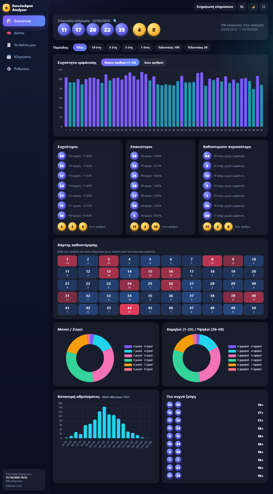
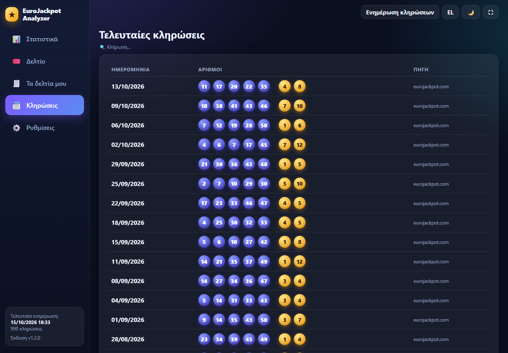
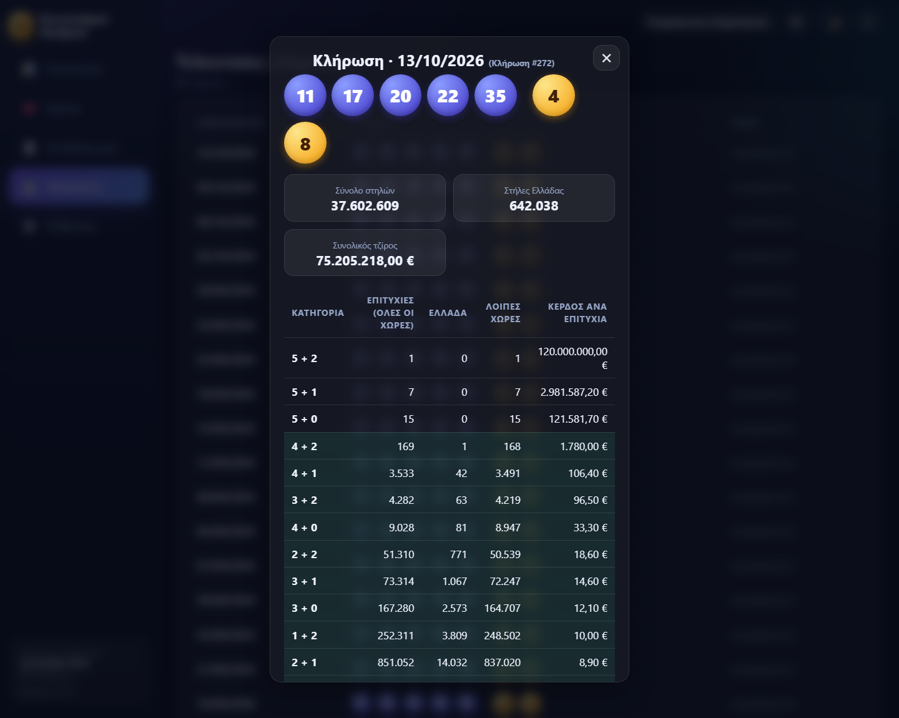
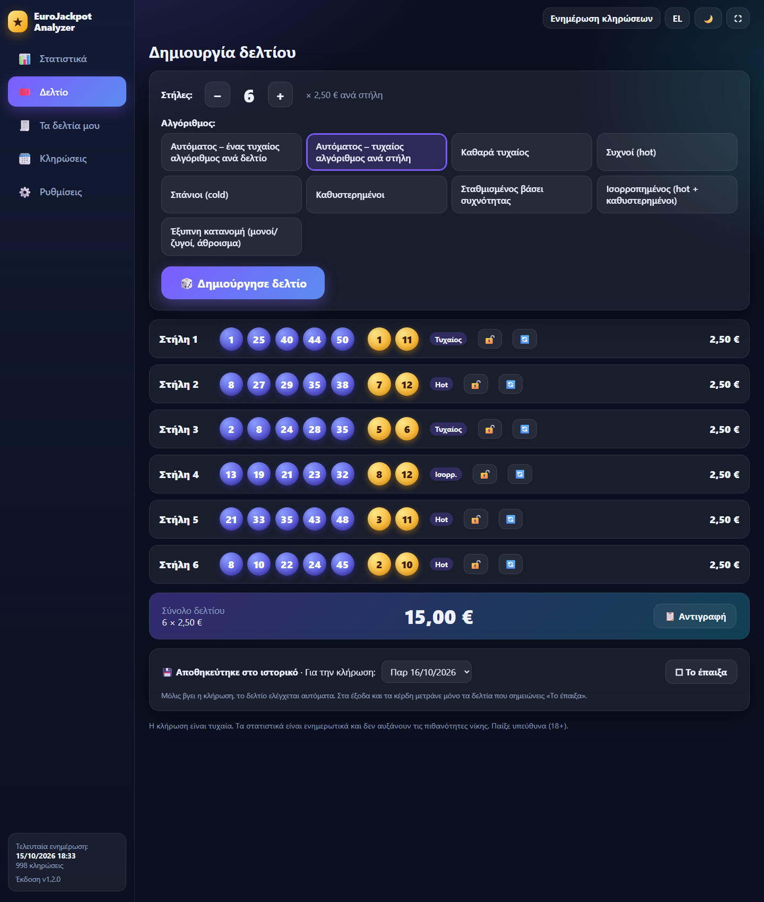
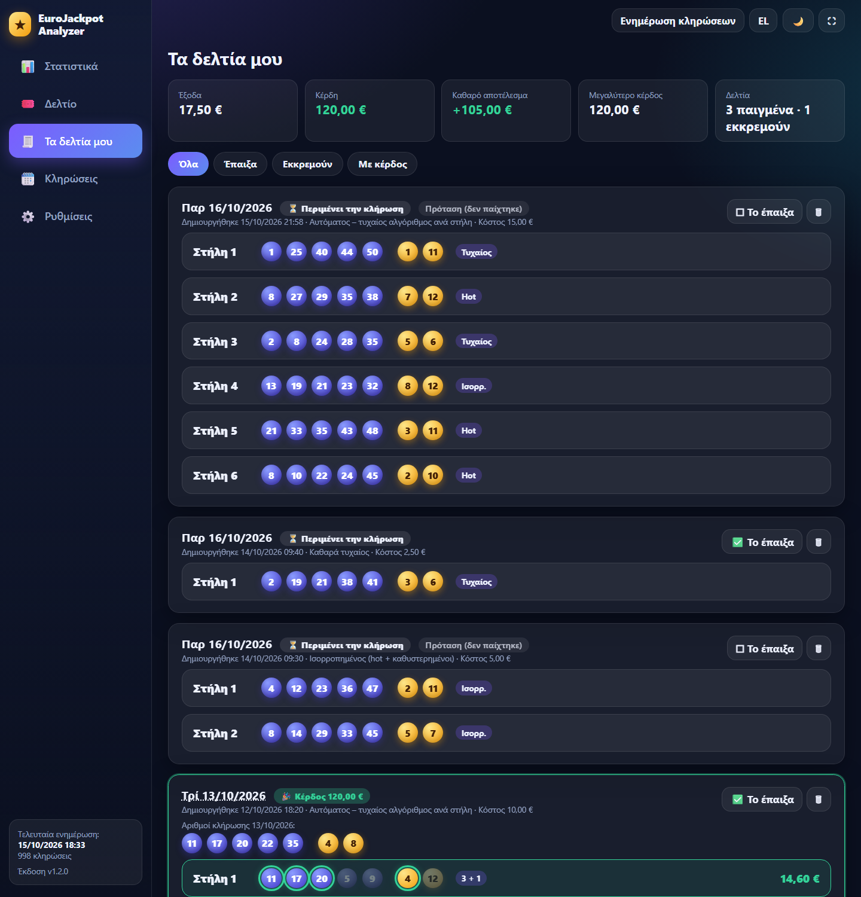
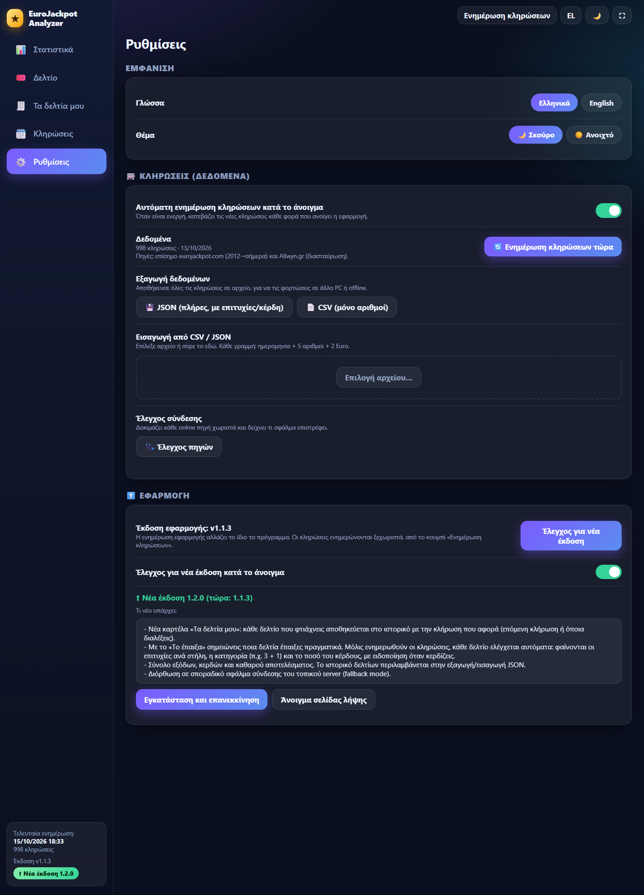
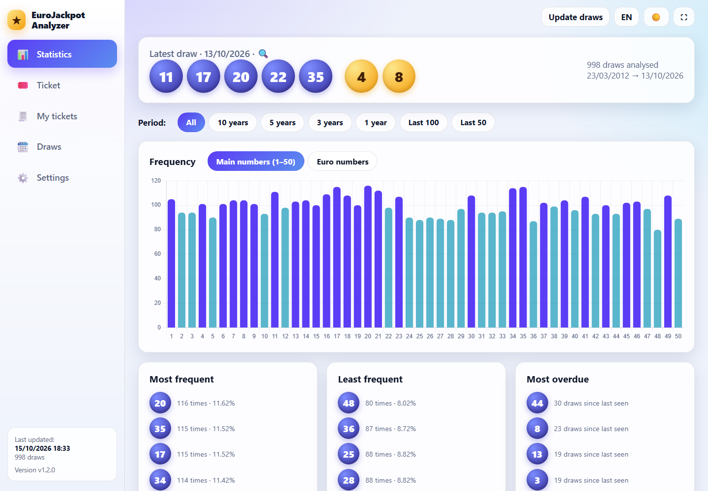

# EuroJackpot Analyzer

Portable πρόγραμμα για Windows που:
- κατεβάζει όλο το ιστορικό του EuroJackpot (από 23/3/2012) και το ενημερώνει μόνο του,
- δείχνει στατιστικά με γραφήματα (συχνότητα, καθυστέρηση, μονοί/ζυγοί, άθροισμα, ζεύγη),
- δείχνει για κάθε κλήρωση τις επιτυχίες και τα κέρδη (σύνολο χωρών, Ελλάδα, κέρδος ανά επιτυχία),
- φτιάχνει δελτία 1–12 στηλών (2,50 € ανά στήλη) με 7 αλγορίθμους ή αυτόματη επιλογή,
- **κρατά ιστορικό των δελτίων σου και τα ελέγχει αυτόματα μόλις βγει η κλήρωση**, με ποσό κέρδους και συνολικό αποτέλεσμα,
- εξάγει/εισάγει τα δεδομένα σου (JSON, CSV) και ενημερώνεται από GitHub με ένα κλικ.

Ελληνικά / English, σκούρο / ανοιχτό θέμα, παράθυρο ή πλήρης οθόνη (F11).

---

## Οδηγίες χρήσης

### 1. Εγκατάσταση και πρώτη εκκίνηση
1. Κατέβασε το `EuroJackpotApp-portable-win.zip` από τη σελίδα **Releases** και κάν' το «Εξαγωγή όλων» σε οποιονδήποτε φάκελο.
2. Τρέξε το `EuroJackpotApp.exe`. Δεν χρειάζεται εγκατάσταση. Χρειάζεται μόνο το *Microsoft Edge WebView2*, που υπάρχει ήδη σε Windows 10/11.
3. Η εφαρμογή ανοίγει αμέσως με το ιστορικό που περιέχει μέσα της. Αν υπάρχει internet, κατεβάζει και τις νεότερες κληρώσεις.
4. Τα δεδομένα και οι ρυθμίσεις σώζονται στον φάκελο `data` δίπλα στο exe. Για να μεταφέρεις την εφαρμογή σε άλλο PC, αντίγραψε όλο τον φάκελο.

### 2. Στατιστικά
Η αρχική οθόνη δείχνει την τελευταία κλήρωση και τα στατιστικά όλων των κληρώσεων.
- **Περίοδος**: διάλεξε Όλες, 10, 5, 3, 1 έτη ή τις τελευταίες 100 / 50 κληρώσεις.
- **Συχνότητα εμφάνισης**: μπάρες για τους κύριους αριθμούς (1–50) ή τους Euro αριθμούς. Με το ποντίκι πάνω σε μια μπάρα βλέπεις ποσοστό και καθυστέρηση.
- **Συχνότεροι / Σπανιότεροι / Καθυστερούν περισσότερο**: οι 7 πρώτοι κύριοι και οι 3 Euro αριθμοί κάθε λίστας.
- **Χάρτης καθυστέρησης**: κάθε κελί δείχνει τον αριθμό και πόσες κληρώσεις έχουν περάσει από την τελευταία φορά που βγήκε (πιο κόκκινο = καθυστερεί περισσότερο).
- Πίτες μονοί/ζυγοί και χαμηλοί/υψηλοί, κατανομή αθροίσματος και τα πιο συχνά ζεύγη.

> Οι Euro αριθμοί άλλαξαν εύρος στο παρελθόν (1–8, από 10/2014 1–10, από 3/2022 1–12). Τα στατιστικά μετρούν μόνο τις κληρώσεις στις οποίες ο αριθμός υπήρχε.

### 3. Κληρώσεις και λεπτομέρειες
Στο μενού **Κληρώσεις** βλέπεις τις τελευταίες 100 κληρώσεις:

**Κάνε κλικ σε μια κλήρωση** (ή στην τελευταία κλήρωση της αρχικής οθόνης) για να δεις τις επιτυχίες και τα κέρδη ανά κατηγορία:

- **Επιτυχίες (όλες οι χώρες)**: το σύνολο των νικητών σε όλες τις συμμετέχουσες χώρες.
- **Ελλάδα** και **Λοιπές χώρες**: οι νικητές στην Ελλάδα και οι υπόλοιποι (διαθέσιμο από 8/3/2024, όταν μπήκε η Ελλάδα στο παιχνίδι).
- **Κέρδος ανά επιτυχία**, **σύνολο στηλών** και **τζίρος** της κλήρωσης.
- Η κατηγορία **1 + 1** ισχύει μόνο στην Ελλάδα.
- Οι πηγές δεν δίνουν ανάλυση ανά χώρα, μόνο σύνολο όλων των χωρών και Ελλάδα.

### 4. Δημιουργία δελτίου

1. Διάλεξε **1–12 στήλες** με τα κουμπιά − / +.
2. Διάλεξε **αλγόριθμο**:
   - *Αυτόματος – ένας τυχαίος αλγόριθμος ανά δελτίο*, ή *τυχαίος αλγόριθμος ανά στήλη*.
   - *Καθαρά τυχαίος, Συχνοί (hot), Σπάνιοι (cold), Καθυστερημένοι, Σταθμισμένος βάσει συχνότητας, Ισορροπημένος, Έξυπνη κατανομή (μονοί/ζυγοί, άθροισμα)*.
3. Πάτα **Δημιούργησε δελτίο**. Δίπλα σε κάθε στήλη φαίνεται ο αλγόριθμος που τη δημιούργησε και η τιμή της (2,50 €). Κάτω φαίνεται το **σύνολο του δελτίου**.
4. Με το 🔒 κλειδώνεις μια στήλη που σου αρέσει, με το 🔄 ξαναφτιάχνεις μόνο εκείνη και με το **Αντιγραφή** παίρνεις όλο το δελτίο ως κείμενο.
5. Στο κάτω μέρος βλέπεις ότι το δελτίο **αποθηκεύτηκε στο ιστορικό** για την επόμενη κλήρωση (μπορείς να διαλέξεις άλλη ημερομηνία). Αν το παίξεις πραγματικά, πάτα **«Το έπαιξα»**.
   Όσο δεν το έχεις σημειώσει ως παιγμένο, ένα νέο «Δημιούργησε δελτίο» αντικαθιστά την πρόταση, χωρίς να γεμίζει το ιστορικό.

> Η κλήρωση είναι τυχαία. Τα στατιστικά είναι ενημερωτικά και δεν αυξάνουν τις πιθανότητες νίκης. Παίξε υπεύθυνα (18+).

### 5. Τα δελτία μου: ιστορικό και έλεγχος κερδών

Στην καρτέλα **Τα δελτία μου** βλέπεις όλα τα δελτία που έφτιαξες, από το πιο πρόσφατο:
- **Αυτόματος έλεγχος**: μόλις ενημερωθούν οι κληρώσεις (κουμπί «Ενημέρωση κληρώσεων» ή αυτόματα στο άνοιγμα), κάθε δελτίο συγκρίνεται με την κλήρωση που αφορούσε. Οι αριθμοί που βγήκαν σημαδεύονται με πράσινο, και κάθε στήλη δείχνει την κατηγορία (π.χ. *3 + 1*) και το **ποσό του κέρδους**.
- **Ειδοποίηση**: αν κερδίσεις σε δελτίο που έπαιξες, εμφανίζεται μήνυμα και πράσινος αριθμός δίπλα στην καρτέλα.
- **Σύνολα**: έξοδα, κέρδη, καθαρό αποτέλεσμα και μεγαλύτερο κέρδος. Μετράνε **μόνο τα δελτία που σημείωσες «Το έπαιξα»**. Οι υπόλοιπα μένουν ως «Πρόταση (δεν παίχτηκε)» και ελέγχονται κι αυτά, χωρίς να μπαίνουν στα σύνολα.
- **Φίλτρα**: Όλα, Έπαιξα, Εκκρεμούν, Με κέρδος. Με κλικ στην ημερομηνία ανοίγουν οι λεπτομέρειες της κλήρωσης.
- Τα ποσά προέρχονται από τα πραγματικά κέρδη ανά επιτυχία της κλήρωσης. Η κατηγορία **1 + 1** (0,50 € add-on) πληρώνει 2,50 € και ισχύει μόνο για κληρώσεις από 8/3/2024.
- Το ιστορικό δελτίων **περιλαμβάνεται στην εξαγωγή JSON** και φορτώνεται μαζί με τις κληρώσεις σε άλλο PC.

### 6. Ρυθμίσεις: γλώσσα, θέμα, δεδομένα, εξαγωγή και εισαγωγή

Η **γλώσσα** (Ελληνικά / English) και το **θέμα** (σκούρο / ανοιχτό) αλλάζουν αμέσως, από τα κουμπιά πάνω δεξιά ή από τις Ρυθμίσεις. Παράδειγμα στα αγγλικά με ανοιχτό θέμα:

**Ενημέρωση κληρώσεων** και **ενημέρωση εφαρμογής** είναι δύο ξεχωριστά πράγματα:

| | Τι αλλάζει | Πού |
|---|---|---|
| **Ενημέρωση κληρώσεων** | Τα αποτελέσματα των κληρώσεων | Κουμπί «Ενημέρωση κληρώσεων» (πάνω δεξιά) ή αυτόματα κατά το άνοιγμα (διακόπτης στις Ρυθμίσεις) |
| **Ενημέρωση εφαρμογής** | Το ίδιο το πρόγραμμα (νέα έκδοση) | Ρυθμίσεις → Εφαρμογή → «Έλεγχος για νέα έκδοση». Αν υπάρχει νέα έκδοση εμφανίζεται πράσινο σήμα στο μενού |

- **Εξαγωγή δεδομένων**: αποθηκεύει όλες τις κληρώσεις σε **JSON** (πλήρες, με επιτυχίες και κέρδη) ή **CSV** (μόνο αριθμοί), ώστε να τις ανεβάσεις σε άλλο PC ή σε άλλο πρόγραμμα, ακόμα και offline.
- **Εισαγωγή από CSV / JSON**: επίλεξε αρχείο ή σύρε το στο πλαίσιο. Δέχεται τα αρχεία που εξάγει η ίδια η εφαρμογή και απλά CSV με ημερομηνία + 5 αριθμούς + 2 Euro. Οι κληρώσεις συγχωνεύονται χωρίς διπλότυπα.
- **Έλεγχος σύνδεσης**: δοκιμάζει κάθε online πηγή χωριστά και δείχνει το σφάλμα. Με το «Αντιγραφή αναφοράς» μπορείς να το στείλεις για διάγνωση.
- **Έλεγχος και εγκατάσταση νέας έκδοσης** (κάτω στη σελίδα, στην εικόνα παραπάνω): όταν υπάρχει νέα έκδοση φαίνονται οι αλλαγές της. Με το «Εγκατάσταση και επανεκκίνηση» κατεβάζει το νέο zip από το GitHub, ελέγχει το SHA-256, αντικαθιστά τα αρχεία (ο φάκελος `data` με τα δεδομένα και τα δελτία σου μένει ανέγγιχτος) και ξανανοίγει την εφαρμογή.

### 7. Αν δεν δουλεύει η online ενημέρωση
Η εφαρμογή **δεν μπλοκάρει**. Έχει ενσωματωμένο ιστορικό, οπότε ανοίγει πάντα με δεδομένα. Αν δεν υπάρχουν καθόλου δεδομένα, εμφανίζεται οθόνη όπου μπορείς να **φορτώσεις χειροκίνητα αρχείο κληρώσεων** (κουμπί ή drag & drop), να ξαναδοκιμάσεις ή να τρέξεις **Έλεγχο σύνδεσης**.

Συνηθισμένες αιτίες σφάλματος `403 Forbidden`: VPN, εταιρικό δίκτυο/proxy ή antivirus που μπλοκάρει το εξωτερικό API. Δοκίμασε χωρίς VPN ή από άλλο δίκτυο, ή χρησιμοποίησε εξαγωγή/εισαγωγή αρχείου από ένα PC που δουλεύει.

### 8. Προβλήματα εκκίνησης
- **«Windows protected your PC» (SmartScreen)**: η εφαρμογή δεν έχει ψηφιακή υπογραφή (πληρωμένο πιστοποιητικό), οπότε τα Windows τη θεωρούν «άγνωστο εκδότη». Πάτα **More info → Run anyway**. Εμφανίζεται μία φορά.
- **Σφάλμα `Failed to resolve Python.Runtime.Loader.Initialize` (παλιότερες εκδόσεις)**: τα Windows μαρκάρουν τα αρχεία ενός zip από το internet ως «μπλοκαρισμένα» και σε ορισμένα PC το .NET δεν φορτώνει την DLL. Από την έκδοση 1.1.3 η εφαρμογή αφαιρεί μόνη της τη σήμανση. Σε παλιότερη έκδοση, τρέξε σε PowerShell `Get-ChildItem "<φάκελος εφαρμογής>" -Recurse | Unblock-File`, ή κάνε δεξί κλικ στο zip → *Properties* → **Unblock** πριν την εξαγωγή.
- Αν παρ' όλα αυτά το native παράθυρο δεν ανοίξει, η εφαρμογή ανοίγει αυτόματα σε παράθυρο Edge (app mode) και δουλεύει κανονικά. Το σφάλμα γράφεται στο `data\startup.log`.
- **Λευκό παράθυρο ή δεν ανοίγει**: εγκατάστησε το *Microsoft Edge WebView2 Runtime* από τη Microsoft. Αν δεν βοηθήσει, τρέξε το `EuroJackpotApp.exe --browser`.
- Απαιτήσεις: Windows 10 (1803+) ή 11, με Microsoft Edge.

---

## For developers

- **From source**: `python -m venv .venv && .venv\Scripts\pip install -r requirements.txt && .venv\Scripts\python run.py`
- **Browser dev mode**: `python -m app.devserver 8765`, then open http://127.0.0.1:8765/index.html. Helpful URL params (docs/screenshots): `#view=ticket&lang=en&theme=light&draw=2026-10-13&gen=8`
- **Tests**: `.venv\Scripts\python -m pytest -q`
- **Offline seed** (bundled history): `python -m tools.make_seed`
- **Build**: `powershell -ExecutionPolicy Bypass -File build\build_windows.ps1` → `dist\EuroJackpotApp\`
- **Release** (needs `gh auth login` and `GITHUB_REPO` in `app/version.py`): `powershell -ExecutionPolicy Bypass -File build\release.ps1`

### Data sources
- Official EuroJackpot service (eurojackpot.com): full history since 2012-03-23, numbers + prizes.
- Allwyn/OPAP API (game 5149): since 2024-03-08, Greek winners; fallback and cross-check.
- Manual import of JSON / CSV.
